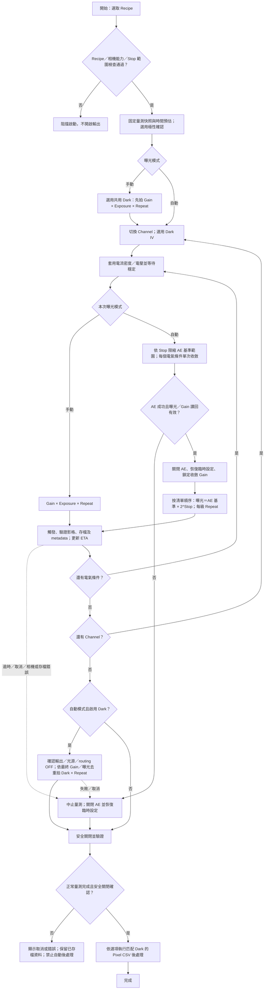

# Recipe 自動曝光／Stop 流程模擬報告

日期：2026-11-04（Asia/Taipei）。

本報告保留加入各 Channel ROI 前的模擬紀錄；現行整合流程見 [Recipe 各 Channel ROI](RECIPE_CHANNEL_ROI.md)。同日整合推送前最新回歸為相關 **179／179**、完整套件 **846／846 通過**，取代本報告末尾引用的先前完整測試狀態；模擬資料與實機驗收範圍不變。

**結果：14／14 個情境符合預期；既有相關回歸測試 152／152 通過。**

本輪使用實際 `ELMatrixRunner`、Recipe 計畫、快照／檔案輸出與 Pixel CSV 後處理，搭配可追蹤輸出、routing、AE 狀態的模擬硬體。未連接或操作實體相機、SMU、Relay、光源。AE 收斂值為預設輸入，用來驗證控制流程，未模擬真實亮度回授的收斂品質。

新增模擬程式及結果位於本機 `local/`，不變更正式硬體控制程式。重現指令：

```powershell
.venv\Scripts\python.exe local/simulate_recipe_ae_flow.py
```

## 情境結果

異常情境的「通過」表示系統依預期中止或阻擋，不表示量測成功；第 12 項刻意回傳安全關閉未確認，確認 Pixel CSV 被拒絕。

| # | 情境 | AE 次數 | EL | Dark | Pixel CSV | 結果 |
| --- | --- | ---: | ---: | ---: | ---: | --- |
| 1 | 雙通道／定電流密度／指定 Gain | 4 | 40 | 16 | 136 | 符合預期 |
| 2 | 定電壓／自動 Gain | 2 | 20 | 20 | 80 | 符合預期 |
| 3 | 自訂順序、小數及省略 0 Stop | 2 | 12 | 6 | 42 | 符合預期 |
| 4 | 手動矩陣回歸（先拍 Dark） | 0 | 16 | 8 | 56 | 符合預期 |
| 5 | 自動曝光停用 Dark | 2 | 12 | 0 | 0 | 符合預期 |
| 6 | 啟用極性與 Dark IV 階段 | 2 | 20 | 16 | 76 | 符合預期 |
| 7 | AE 收斂逾時 | 1 | 0 | 0 | 0 | 符合預期 |
| 8 | AE 期間取消 | 1 | 0 | 0 | 0 | 符合預期 |
| 9 | AE 基準超出 Stop 可用範圍 | 1 | 0 | 0 | 0 | 符合預期 |
| 10 | 微秒精度造成曝光重複 | 1 | 0 | 0 | 0 | 符合預期 |
| 11 | 第 3 張拍攝失敗 | 1 | 2 | 0 | 0 | 符合預期 |
| 12 | 安全關閉未確認 | 2 | 20 | 16 | 0 | 符合預期 |
| 13 | 指定 Gain 漂移 | 1 | 0 | 0 | 0 | 符合預期 |
| 14 | 重複 Stop 預檢阻擋 | 0 | 0 | 0 | 0 | 符合預期 |

## 主情境：雙通道指定 Gain

- CH1、CH2，各 2 個電流密度條件（2、4 mA/cm²）；指定 Gain 200%，Repeat 2。
- 自訂清單 `-2, -1, 0, 0.5, 2`，輸入順序不重排；每個電氣條件僅 AE 一次，共 4 次。
- 每個 Channel 的兩個條件分別模擬收斂為 500 ms、1000 ms。Gain 固定於 200%，所有 Stop 只改曝光時間。
- 共 `2 × 2 × 5 × 2 = 40` 張 EL。兩通道共用 8 組唯一 Gain／曝光，Dark 為 `8 × 2 = 16` 張，合計 **56 張**。
- 啟動前最多估算 80 張、684.253 秒；每次 AE 後立即替換整組 Stop 的曝光預算並扣除重複 Dark，最終剩餘時間為 0 秒（浮點誤差 < 1e-6）。虛擬時間只驗證流程與預算消耗，不代表實機所需時間。

| AE 基準 | −2 Stop | −1 Stop | 0 Stop | +0.5 Stop | +2 Stop |
| --- | ---: | ---: | ---: | ---: | ---: |
| 500 ms | 125 ms | 250 ms | 500 ms | 707.107 ms | 2000 ms |
| 1000 ms | 250 ms | 500 ms | 1000 ms | 1414.214 ms | 4000 ms |

以上每格拍 2 次。所有 EL 完成後才關閉輸出並拍共用 Dark，Dark 不重新做 AE。

## 自動核對項目

1. routing 切換前輸出須關閉；EL 時須有正確路由與輸出；Dark 時輸出、routing、AE 皆關閉。
2. 同一電氣條件所有 Stop／Repeat 的 Gain 相同；manifest 的 Stop 順序及基準 × 2^Stop 與實際微秒曝光一致。
3. 不以不同 Gain 或 Repeat 的 Dark 混配；不同條件的相同 Gain／曝光可共用 Dark。
4. 成功情境的最終進度 `current == total == manifest 張數`，ETA 歸零；錯誤情境不假裝完成。
5. 安全關閉確認後才啟動後處理；安全關閉未確認時禁止 Pixel CSV。
6. 使用合成影像：Dark 固定 100 DN；EL 為 `100 + round(曝光 ms × Gain/100 × 0.1)` DN。每個 Pixel CSV 的全部 12 個像素逐一比對 RAW、暗扣除及暗扣除／實際曝光時間，主情境共 **136 個檔案**均符合預期。曝光正規化未做 Gain 校正。
7. 極性與 Dark IV 情境驗證階段順序；Dark IV 使用單點假資料，不作完整 I–V 模型或硬體計量驗證。

SDK 的 Gain 策略、臨時範圍恢復、讀回、逾時、取消、斷線及晚到事件另由本輪重跑的 `tests/test_recipe_auto_exposure.py` 涵蓋（模擬 SDK，非實機）。

## 流程圖

[Mermaid 原始檔](RECIPE_AUTO_EXPOSURE_FLOW.mmd)；簡化自動曝光流程圖：[PNG](../local/recipe_flow_simulation_flow.png)、[SVG](../local/recipe_flow_simulation_flow.svg)。



## 證據與範圍

- [情境彙總 JSON](../local/recipe_flow_simulation_20261104_073351/summary.json)。每個情境另有 `trace.json`、`progress.json`、`result.json`；量測目錄內有快照、manifest、TIFF 及 metadata。
- [主情境事件紀錄](../local/recipe_flow_simulation_20261104_073351/01_fixed_current_two_channels/trace.json)。
- [主情境進度紀錄](../local/recipe_flow_simulation_20261104_073351/01_fixed_current_two_channels/progress.json)。
- [本輪回歸紀錄](../local/recipe_flow_simulation_tests.log)：152 項通過。
- [模擬完成介面截圖](../local/recipe_flow_simulation_complete.png)：以本輪實際進度紀錄重播至介面，標示為模擬；非實機截圖。
- 本輪未修改正式程式，未重跑完整套件。前一輪完整測試仍為 822／823，唯一失敗是既有光源 GUI worker 等待逾時；此 14 情境及 152 相關測試的通過不取代該完整測試紀錄。
- 保留原有暫存／未提交變更；本輪不備份、不 commit、不 push。實機仍需確認 AE 收斂、SDK 讀回、取消／斷線、光源與 SMU 實際關閉，以及 Dark 熱漂移。
